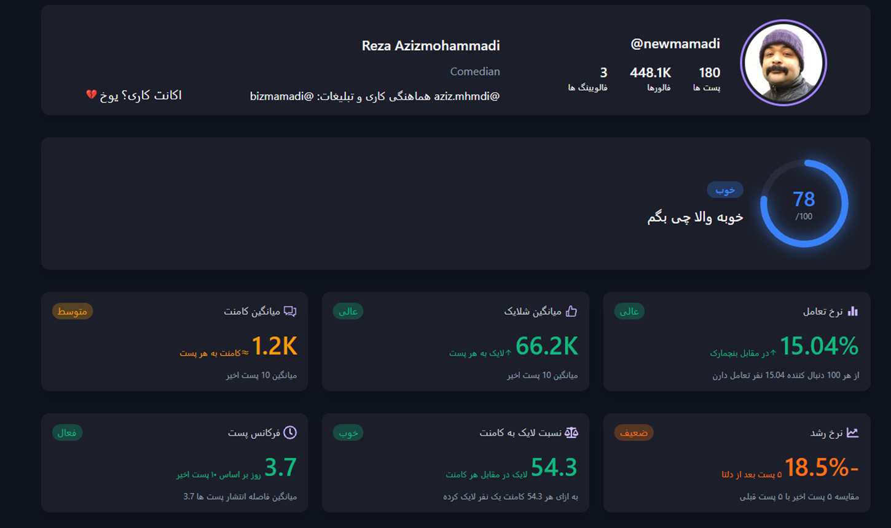

# پولتو به کص گاو نزن
قبل اینکه از یه پیج تبلیغ بخری، اول انالیزش کن ببین چه خبره

### خب حالا دقیقا چیکار میکنه؟
- اطلاعات پیج رو میده
- نمره کلی رو میده
- تعامل فالورهارو تحلیل میکنه
- رشد رو بر اساس پست ها نشون میده
- و همین دیگه

## تکنولوژی های استفاده شده

### backend

### frontend

